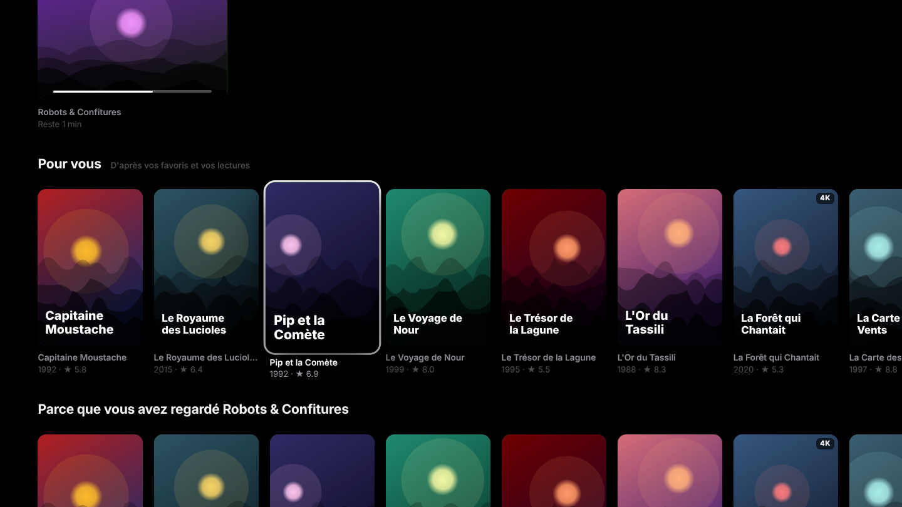
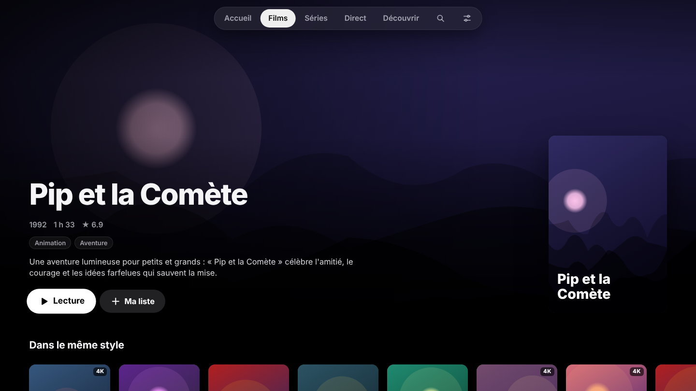
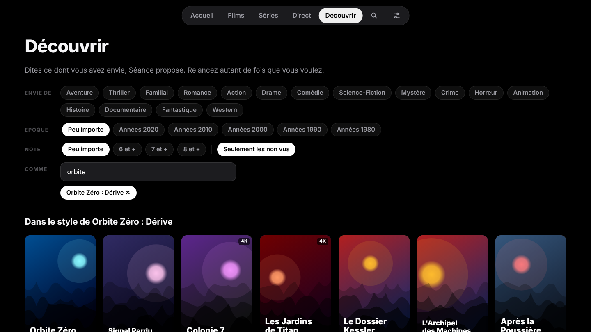
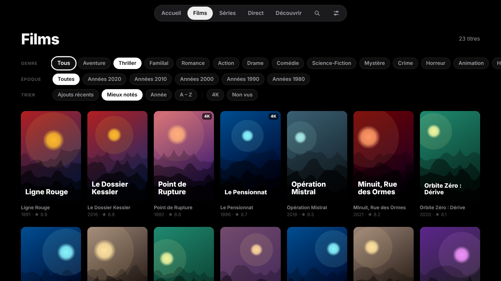

# Séance

Un lecteur IPTV personnel, avec une interface pensée pour le salon : grandes images,
rangées qui défilent, navigation à la télécommande. Séance se branche sur votre
abonnement (compte **Xtream Codes** ou playlist **M3U**) et range vos films, vos
séries et vos chaînes pour qu'on s'y retrouve.

**[Ouvrir Séance en ligne](https://lonjhe.github.io/Test-git/)** — sans rien
installer. La page affiche un catalogue de démonstration ; dans **Réglages**, vous
pouvez y brancher votre abonnement (voir « Version en ligne » plus bas pour ses
limites).



| Fiche film et « Dans le même style » | Découvrir : l'outil de proposition |
| --- | --- |
|  |  |



## Démarrer

Il faut [Node.js](https://nodejs.org) 20 ou plus récent.

```bash
npm install
npm start
```

Ouvrez ensuite <http://localhost:8080>. Au premier lancement, Séance propose
d'ajouter une source — ou de lancer la **démonstration** (catalogue fictif et clip
de test) pour découvrir l'interface sans abonnement.

Pour regarder sur la télévision, une tablette ou un téléphone, laissez Séance
tourner sur un ordinateur de la maison (PC, NAS, Raspberry Pi…) et ouvrez dans le
navigateur de l'appareil l'adresse « réseau local » affichée au démarrage, par
exemple `http://192.168.1.20:8080`.

## Ce que fait Séance

**Des films faciles à retrouver**

- Titres nettoyés : `FR - Inception (2010) [4K HDR]` devient « Inception », 2010, 4K.
- Les différentes versions d'un même film (4K, VOSTFR, MKV…) sont regroupées sous
  une seule fiche, avec un sélecteur de version.
- Bibliothèque filtrable par **genre**, **collection** (les catégories de votre
  fournisseur), **époque**, 4K et « non vus » ; tri par ajouts récents, note, année
  ou ordre alphabétique avec index A–Z.
- Recherche instantanée dans les films, séries et chaînes, insensible aux accents.
- « Reprendre la lecture », « Ma liste » et l'historique sont partagés entre tous
  les écrans de la maison.

**Des propositions dans le même style**

- Sur chaque fiche, une rangée **Dans le même style** : suites et films de la même
  saga d'abord, puis les films aux genres communs, de la même époque, bien notés.
- Sur l'accueil, **Pour vous** (d'après vos favoris et vos lectures) et **Parce que
  vous avez regardé…**
- L'onglet **Découvrir** : choisissez une envie (jusqu'à trois genres, une époque,
  une note minimale) ou indiquez un film que vous avez aimé ; Séance propose, et
  vous relancez autant de fois que vous voulez.

**Le reste**

- TV en direct par catégories, programme en cours et suivant (comptes Xtream),
  chaînes favorites, zapping depuis le lecteur.
- Séries par saisons, épisodes marqués comme vus, enchaînement automatique sur
  l'épisode suivant.
- Lecteur plein écran : reprise là où l'on s'était arrêté, pistes audio et
  sous-titres (flux HLS), avance et retour rapides.
- Les catégories pour adultes sont masquées par défaut (réglable).

## Ajouter votre abonnement

Dans **Réglages → Sources** :

| Type | Ce qu'il faut |
| --- | --- |
| Compte Xtream Codes | l'adresse du serveur (`http://exemple.tv:8080`), l'identifiant et le mot de passe |
| Playlist M3U | un lien `.m3u` / `.m3u8`, ou un fichier à importer |

Un lien M3U du type `…/get.php?username=…&password=…` est reconnu et converti en
compte Xtream, qui donne des fiches plus riches (résumés, épisodes, programme TV).
Le catalogue est mis en cache et rafraîchi toutes les 12 heures.

### Genres précis et meilleures recommandations (facultatif)

Sans réglage, les genres sont déduits des catégories du fournisseur (« FR | ACTION »
→ Action). Pour un classement plus fin, ajoutez une clé gratuite
[TMDB](https://www.themoviedb.org/settings/api) dans **Réglages → Fiches et genres** :
Séance parcourt alors le catalogue en tâche de fond pour attribuer à chaque film ses
vrais genres, un résumé en français, une image de fond et la distribution, et tient
compte des recommandations de TMDB dans « Dans le même style ».

## Télécommande et clavier

| Touche | Action |
| --- | --- |
| Flèches | déplacer le focus |
| Entrée / OK | valider |
| Retour, Échap, Retour arrière | page précédente |
| Dans le lecteur : ← → | reculer / avancer de 10 s |
| Espace, K, ▶⏸ | lecture / pause |
| J / L, ⏪ ⏩ | reculer / avancer de 30 s |
| Page préc. / suiv., CH+ / CH− | chaîne ou épisode précédent / suivant |
| F, M | plein écran, couper le son |

À la souris ou au doigt, l'interface réagit au survol et au toucher ; dès qu'une
flèche est pressée, elle repasse en mode télécommande.

## Configuration

| Variable | Défaut | Rôle |
| --- | --- | --- |
| `PORT` | `8080` | port d'écoute |
| `HOST` | `0.0.0.0` | `127.0.0.1` pour n'accepter que cet ordinateur |
| `SEANCE_DATA` | `./data` | dossier des réglages, de l'état de lecture et des caches |
| `SEANCE_USER_AGENT` | `Mozilla/5.0 (Seance IPTV Player)` | à changer si votre fournisseur filtre les lecteurs |

## Version en ligne ou installation chez soi ?

| | En ligne (GitHub Pages) | Installée chez vous (`npm start`) |
| --- | --- | --- |
| Installation | aucune | Node.js sur un ordinateur de la maison |
| Qui se connecte au fournisseur | votre navigateur, directement | le serveur Séance, qui relaie les flux |
| Fournisseurs compatibles | ceux accessibles en **HTTPS** et qui acceptent les appels venant d'un site web | tous |
| Identifiants, favoris, reprises | conservés dans le navigateur de chaque appareil | conservés sur le serveur, partagés entre tous les écrans |

La version en ligne n'a pas de serveur : les navigateurs interdisent à une page
sécurisée (HTTPS) d'appeler une adresse en HTTP, et exigent que le site appelé
l'autorise. Beaucoup de fournisseurs IPTV ne proposent que du HTTP ; dans ce cas la
connexion ou la lecture échoue en ligne (Séance l'explique) et il faut passer par
l'installation chez soi, qui n'a pas ces limites. Séance essaie d'elle-même la
variante HTTPS de l'adresse que vous saisissez.

## Bon à savoir

- **Formats.** C'est le navigateur qui décode la vidéo. Le HLS, le MPEG-TS et les
  MP4 (H.264/AAC) passent partout ; certains MKV, le HEVC ou le son AC3/DTS dépendent
  de l'appareil. En cas d'échec, le lecteur propose d'essayer une autre version ou
  de copier le lien du flux pour l'ouvrir dans VLC. Séance ne transcode pas.
- **Navigateur.** Il faut un navigateur récent (modules JavaScript). Les téléviseurs
  d'avant 2020 environ ont souvent un navigateur trop ancien : passez alors par un
  boîtier (Android TV, Fire TV…) ou un ordinateur branché en HDMI.
- **Si les chaînes ne démarrent pas**, essayez **Réglages → Options → Direct en
  MPEG-TS**.
- **Sécurité.** Séance est prévu pour le réseau local et n'a pas de mot de passe :
  ne l'exposez pas sur Internet. Vos identifiants restent dans `data/` sur la machine
  qui fait tourner Séance ; le navigateur ne reçoit jamais l'adresse réelle des flux,
  qui passent par le relais intégré.
- Séance est un lecteur : il ne fournit aucun contenu. Utilisez-le avec un abonnement
  ou des playlists dont vous disposez légalement.

## Développement

```bash
npm run dev          # redémarre le serveur à chaque modification
npm test             # tests unitaires + intégration face à un faux fournisseur
npm run build:pages  # construit la démonstration statique dans dist/
```

La démonstration en ligne est publiée par GitHub Actions
(`.github/workflows/pages.yml`) à chaque envoi sur la branche principale. Sans
serveur, c'est `public/js/local.js` qui répond aux routes de l'API dans le
navigateur, en réutilisant le code de `shared/`.

```
server/     serveur Node sans framework : API, relais des flux, cache sur disque
  proxy.js     relais vidéo + réécriture HLS         demo.js  catalogue de démonstration
shared/     logique commune au serveur et au navigateur
  catalog.js   sources → catalogue unifié (titres, versions, genres)
  xtream.js    client de l'API Xtream Codes          m3u.js   lecture des playlists
  tmdb.js      enrichissement TMDB                   details.js  fiches film / série, programme TV
  text.js      nettoyage des titres, genres          recommend.js  moteur « même style »
public/     interface (JavaScript natif, sans étape de build)
  js/focus.js  navigation à la télécommande          js/views/     un fichier par écran
  js/local.js  « serveur » embarqué de la version en ligne
scripts/    construction de la démonstration statique (GitHub Pages)
test/       tests (node --test)
```

Le moteur de recommandation (`shared/recommend.js`) compare les films sur leurs
genres, les mots rares de leur titre (pour repérer les sagas), leur époque et la
catégorie du fournisseur, puis favorise légèrement les mieux notés. Les poids sont
regroupés en tête du fichier pour être ajustés facilement.
